

  

<h1 align="center">SFAAO</h1>

  <strong>Software Forense para Análise de Assinaturas Offline</strong> 
  <strong>Forensic Software for Offline Handwritten Signature Analysis</strong>

---

## 🇧🇷 Português

### O que é o SFAAO?

O **SFAAO — Software Forense para Análise de Assinaturas Offline** é uma plataforma computacional voltada ao apoio técnico e científico na análise comparativa de assinaturas manuscritas digitalizadas.

O sistema foi concebido para auxiliar contextos de **perícia documental, pesquisa científica, validação biométrica e análise de similaridade de assinaturas**, combinando técnicas modernas de Inteligência Artificial com procedimentos de calibração estatística e rastreabilidade dos resultados.

O SFAAO não substitui o perito. Seu propósito é atuar como uma **ferramenta computacional de apoio à análise**, oferecendo métricas, evidências quantitativas e organização técnica do processo comparativo.

---

### Conceito

O SFAAO parte do princípio de que a comparação de assinaturas manuscritas pode ser apoiada por modelos computacionais capazes de extrair representações discriminativas das imagens e medir quantitativamente o grau de similaridade ou distância entre elas.

O sistema integra esse processamento a mecanismos de calibração, comparação individual e em lote, organização de casos e geração de documentação técnica.

---

### Objetivo

O principal objetivo do SFAAO é fornecer uma plataforma especializada para:

- apoiar análises de assinaturas manuscritas offline;
- organizar referências e assinaturas questionadas;
- executar comparações individuais e em lote;
- produzir métricas quantitativas de similaridade ou distância;
- permitir calibração estatística dos critérios de decisão;
- aumentar rastreabilidade, reprodutibilidade e padronização;
- apoiar produção de relatórios técnicos e científicos;
- possibilitar experimentação controlada com diferentes configurações de Inteligência Artificial.

---

### Problema que o SFAAO busca resolver

A análise de assinaturas manuscritas envolve grande variabilidade natural.

Uma mesma pessoa pode apresentar diferenças de forma, pressão, inclinação, velocidade, proporção e distribuição espacial entre assinaturas legítimas. Ao mesmo tempo, falsificações podem reproduzir visualmente diversos aspectos de uma assinatura verdadeira.

Isso torna inadequado depender apenas de comparações visuais simplificadas ou de um único valor de similaridade sem contexto estatístico.

O SFAAO foi desenvolvido para apoiar esse problema por meio de uma abordagem integrada que combina:

- análise computacional;
- Inteligência Artificial;
- comparação quantitativa;
- calibração estatística;
- rastreabilidade;
- organização de casos;
- documentação dos resultados.

---

### Por que o SFAAO é relevante?

O diferencial do SFAAO não está apenas na utilização de Deep Learning.

A plataforma foi projetada como um **ambiente completo de análise**, permitindo integrar treinamento, avaliação, calibração, comparação e documentação dentro de um fluxo único.

Entre seus recursos encontram-se suporte a diferentes famílias de redes neurais, estratégias de treinamento, funções de perda, métricas de comparação e procedimentos de avaliação.

Essa flexibilidade permite que o SFAAO seja utilizado tanto em **pesquisa científica** quanto em cenários profissionais que demandem controle metodológico e rastreabilidade.

---

### Principais características

- análise de assinaturas manuscritas offline;
- arquiteturas baseadas em Deep Learning;
- redes neurais siamesas e outras estratégias de treinamento;
- comparação por similaridade e distância;
- calibração estatística;
- avaliação de FAR, FRR e EER;
- comparação individual e em lote;
- gerenciamento estruturado de casos;
- suporte a múltiplas configurações de modelos;
- geração de resultados e relatórios;
- rastreabilidade dos experimentos;
- execução local;
- versões homologadas para Linux e Windows.

---

### Aplicações

O SFAAO possui potencial de aplicação em:

- perícia documental;
- grafoscopia assistida por computador;
- universidades e centros de pesquisa;
- laboratórios de Inteligência Artificial;
- estudos de biometria comportamental;
- instituições públicas;
- órgãos de investigação;
- ambientes jurídicos;
- pesquisa em reconhecimento de padrões;
- desenvolvimento e avaliação de novos métodos de verificação de assinaturas.

---

### Pesquisa científica

O desenvolvimento do SFAAO é acompanhado por pesquisa científica relacionada à verificação de assinaturas offline, Deep Learning, redes neurais siamesas, calibração estatística e mitigação de diferenças entre populações de dados.

Um manuscrito relacionado à metodologia científica utilizada no projeto foi submetido ao **IEEE Access** e encontra-se atualmente **em processo de revisão por pares**.

> **Status:** manuscript submitted to IEEE Access — under peer review.

A submissão de um manuscrito não representa aceitação ou publicação. Em caso de aprovação, esta seção será atualizada com a referência bibliográfica oficial e o DOI.

---

### Propriedade Intelectual

O software SFAAO possui registro de programa de computador.

📄 **Documento de registro:**  
[Consultar registro do software](publications/software-registration/SFAAO-REGISTRO.pdf)

Este repositório é exclusivamente público e informativo.

**O código-fonte proprietário, modelos, mecanismos internos de segurança, infraestrutura de licenciamento, ativos administrativos e demais componentes confidenciais não são distribuídos neste repositório.**

Informações adicionais relacionadas à propriedade intelectual serão divulgadas conforme a evolução dos respectivos processos de proteção.

---

### SFAAO em funcionamento

As capturas abaixo apresentam o fluxo operacional do **SFAAO 2.3.0**, desde a configuração inicial do ambiente até a análise e geração da documentação pericial.

As imagens são disponibilizadas exclusivamente para demonstração pública da plataforma e não expõem código-fonte proprietário, modelos treinados, chaves, mecanismos internos de segurança ou infraestrutura administrativa.

#### Configuração inicial e acesso

**1. Configuração inicial do administrador**

Configuração do primeiro usuário administrativo responsável pelo ambiente do SFAAO.

  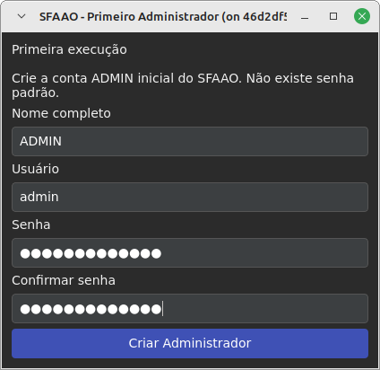

**2. Primeiro acesso**

Tela inicial utilizada para autenticação e acesso ao sistema.

  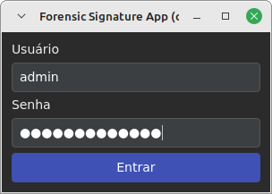

#### Ambiente principal e casos

**3. Janela principal**

Centraliza o acesso às principais funcionalidades operacionais e administrativas do SFAAO.

  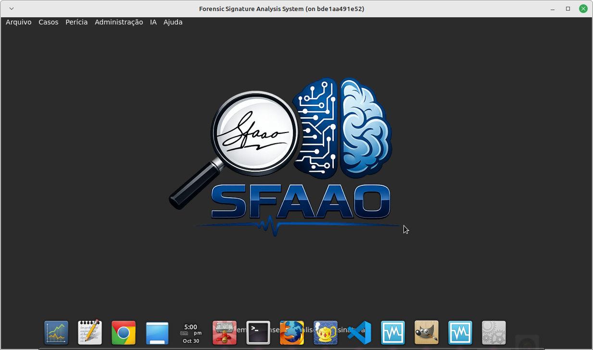

**4. Criação de caso**

Permite cadastrar e identificar de forma estruturada um novo caso pericial.

  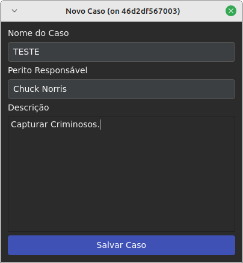

**5. Lista de casos**

Apresenta os casos cadastrados e permite selecionar o caso que será analisado.

  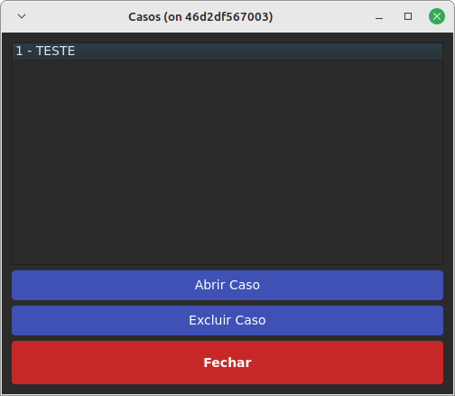

#### Perfil pericial e usuários

**6. Perfil do perito**

Cadastro dos dados profissionais utilizados na identificação do responsável técnico.

  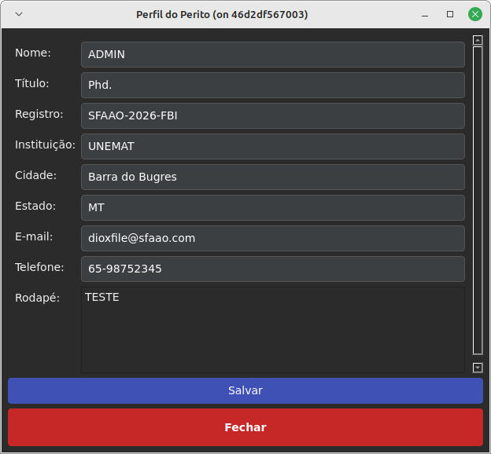

**7. Gerenciamento de usuários**

Permite administrar os usuários autorizados a utilizar a plataforma.

  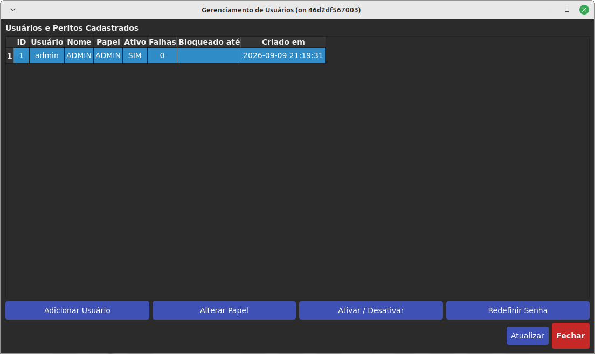

#### Datasets e modelos

**8. Gerenciamento de datasets**

Administração dos conjuntos de dados disponíveis para treinamento e experimentação científica.

  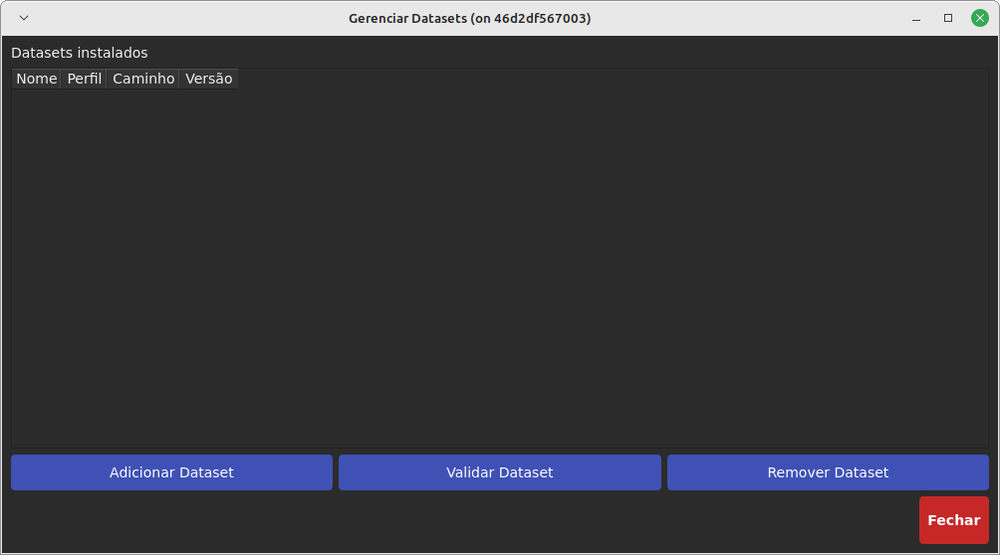

**9. Adição de dataset**

Interface destinada ao cadastro e à integração controlada de novos conjuntos de assinaturas.

  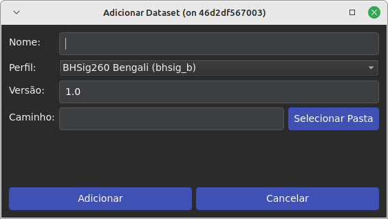

**10. Validação de dataset**

Verificação da estrutura e compatibilidade do conjunto de dados antes de sua utilização.

  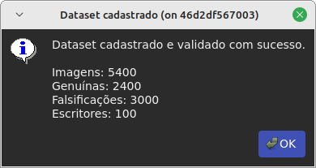

**11. Adição de modelo**

Permite registrar modelos compatíveis com a infraestrutura de análise e experimentação do SFAAO.

  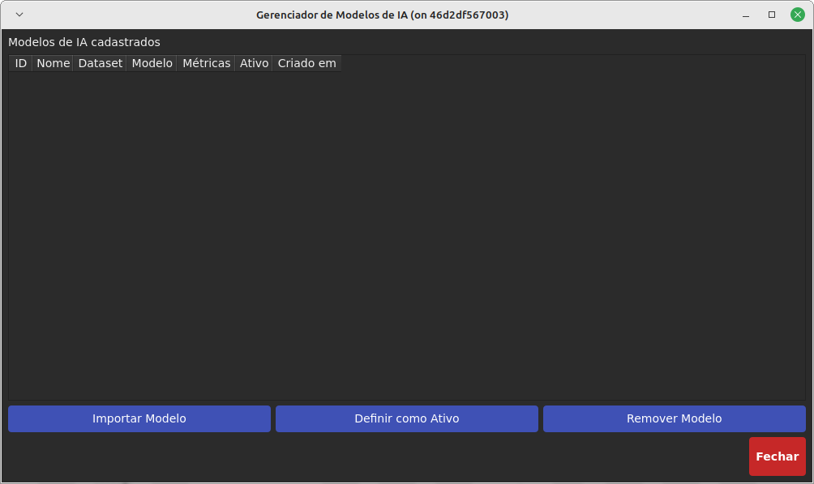

#### Treinamento e monitoramento

**12. Configuração de treinamento**

Ambiente parametrizável para configuração das estratégias e parâmetros utilizados no treinamento.

  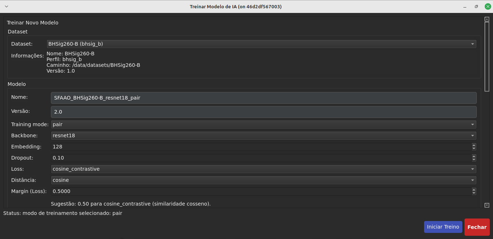

**13. Monitoramento do treinamento**

Permite acompanhar a execução e a evolução do processo de treinamento.

  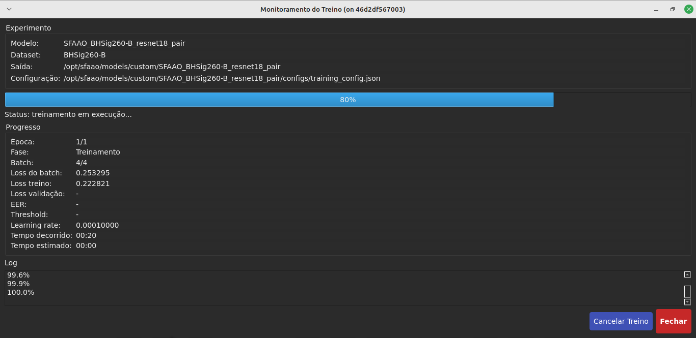

#### Operações do caso

**14. Janela do caso**

Organiza referências, assinaturas questionadas e demais informações associadas ao caso.

  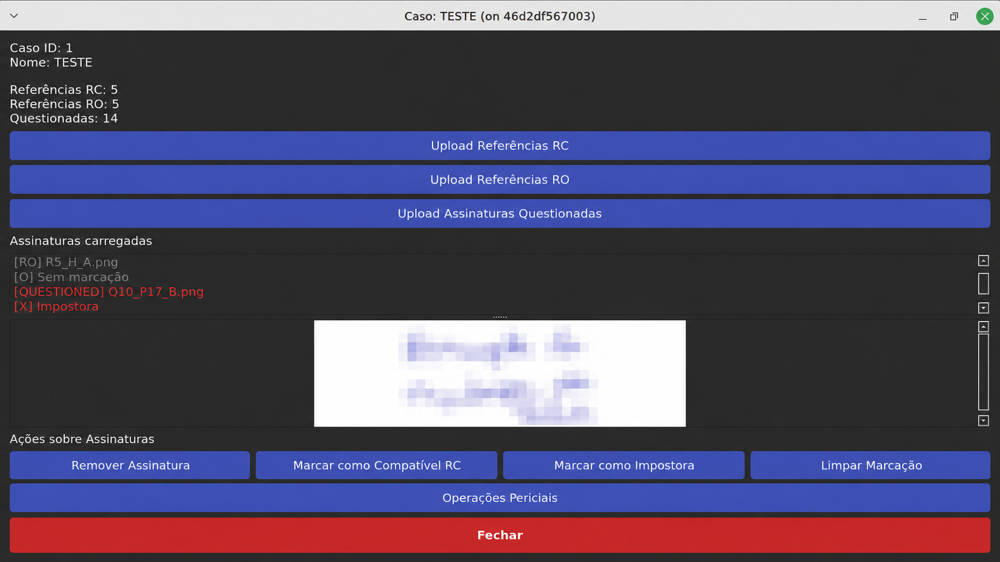

**15. Operações do caso**

Disponibiliza as operações computacionais e periciais aplicáveis ao caso selecionado.

  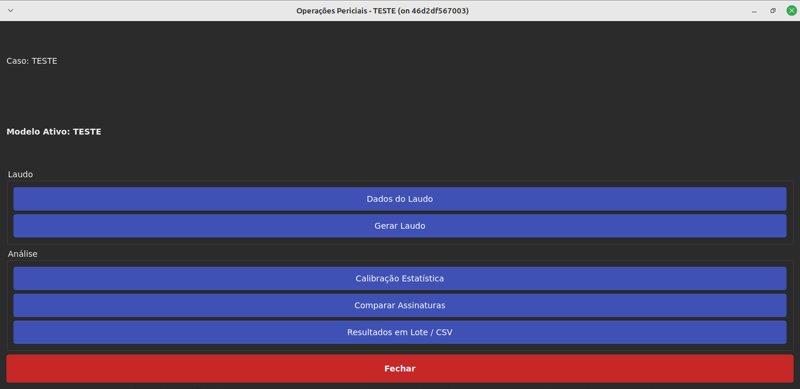

#### Calibração, comparação e resultados

**16. Calibração estatística**

Configuração do procedimento de calibração de acordo com o protocolo aplicado. No SFAAO 2.3.0, a calibração estima FAR, FRR e EER e adota, na interface oficial, um **FAR-alvo operacional fixo de 1%**. O EER é calculado independentemente; a condição **FAR ≤ 1%** é uma restrição empírica observada na população de calibração e não uma garantia de desempenho universal.

  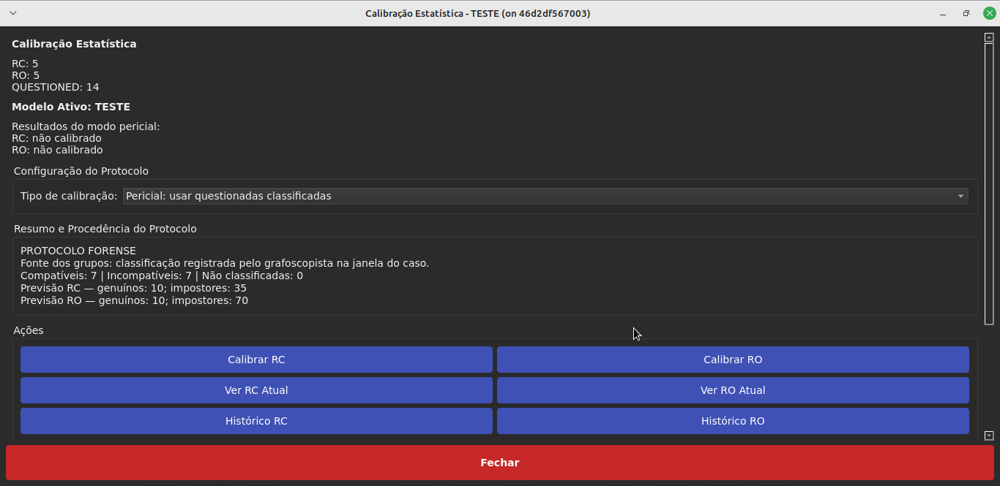

**17. Resultado da calibração**

Apresentação dos resultados estatísticos produzidos pelo procedimento de calibração.

  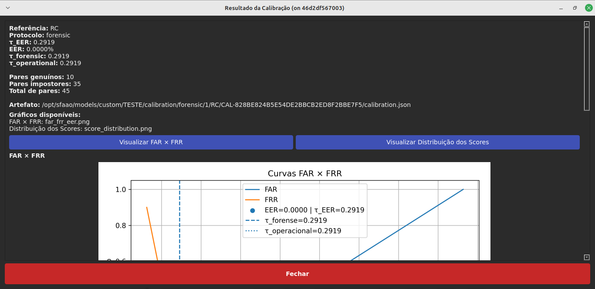

**18. Comparação de assinaturas**

Executa comparações computacionais entre as referências e as assinaturas questionadas.

  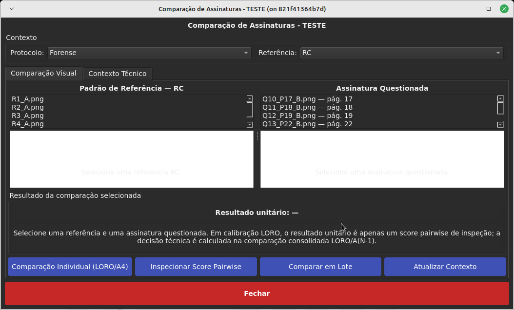

**19. Resultados em lote**

Organiza os resultados obtidos em múltiplas comparações realizadas dentro do caso.

  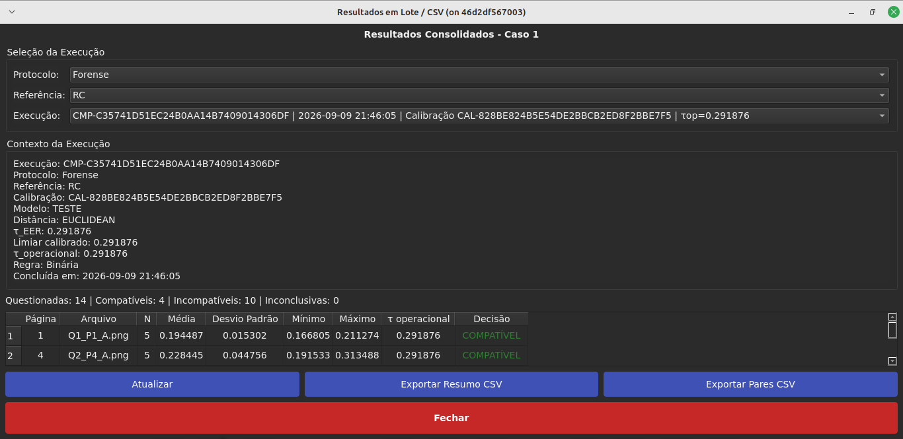

#### Documentação pericial

**20. Laudo pericial**

Organiza os dados técnicos utilizados na elaboração da documentação pericial.

  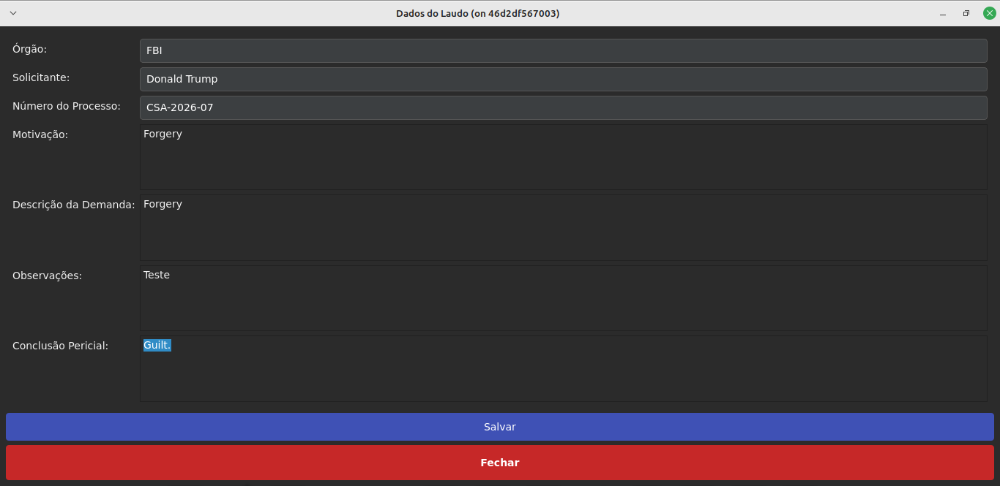

**21. Resultado da geração do laudo**

Apresenta o resultado do processo de geração da documentação estruturada do caso.

  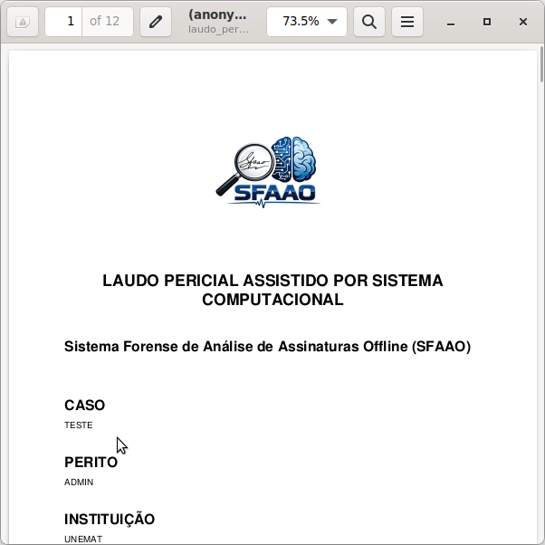

> **Importante:** o SFAAO é uma ferramenta computacional de apoio. A interpretação e a conclusão pericial dependem do protocolo aplicado e do profissional tecnicamente habilitado.

---

### Vídeos

Demonstrações em vídeo serão adicionadas futuramente em:

`media/videos/`

Os vídeos poderão apresentar fluxos operacionais do sistema sem exposição de código-fonte ou componentes proprietários.

---

### Contato

Para informações institucionais, científicas, acadêmicas ou comerciais relacionadas ao SFAAO:

- **Telefone / WhatsApp:** +55 (65) 99946-5280
- **E-mail:** [dioxfile@gmail.com](mailto:dioxfile@gmail.com)
- **GitHub:** [github.com/dioxfile](https://github.com/dioxfile)
- **LinkedIn:** [linkedin.com/in/dioxfile](https://www.linkedin.com/in/dioxfile/)

---

### Aviso

O SFAAO é uma ferramenta de apoio computacional.

Resultados produzidos por sistemas de Inteligência Artificial devem ser interpretados dentro do protocolo aplicado e, em contextos periciais, avaliados por profissionais tecnicamente habilitados.

---

## 🇺🇸 English

### What is SFAAO?

**SFAAO — Forensic Software for Offline Handwritten Signature Analysis** is a computational platform designed to support technical and scientific analysis of digitized handwritten signatures.

The system was created to support **forensic document examination, scientific research, biometric validation and signature similarity analysis**, combining modern Artificial Intelligence techniques with statistical calibration and result traceability.

SFAAO is not intended to replace a forensic examiner. Its role is to operate as a **computational decision-support tool**, providing quantitative metrics, structured evidence and technical organization for the comparison process.

---

### Concept

SFAAO is based on the principle that handwritten signature comparison can be supported by computational models capable of extracting discriminative image representations and quantitatively measuring similarity or distance between signatures.

The platform integrates this processing with calibration procedures, individual and batch comparison, case organization and technical documentation.

---

### Objective

The main objective of SFAAO is to provide a specialized platform for:

- supporting offline handwritten signature analysis;
- organizing reference and questioned signatures;
- performing individual and batch comparisons;
- producing quantitative similarity or distance measurements;
- statistically calibrating decision criteria;
- improving traceability, reproducibility and standardization;
- supporting technical and scientific reporting;
- enabling controlled experimentation with Artificial Intelligence configurations.

---

### The problem SFAAO addresses

Handwritten signatures present substantial natural variability.

The same person may produce legitimate signatures with differences in shape, inclination, proportion and spatial organization. At the same time, skilled forgeries may reproduce several visual characteristics of genuine signatures.

For this reason, relying exclusively on simplified visual comparison or on a single uncalibrated similarity value may be insufficient.

SFAAO addresses this challenge through an integrated approach combining:

- computational analysis;
- Artificial Intelligence;
- quantitative comparison;
- statistical calibration;
- traceability;
- case organization;
- technical documentation.

---

### Why SFAAO matters

SFAAO is not simply a Deep Learning model.

It was designed as a **complete analysis environment**, integrating training, evaluation, calibration, comparison and documentation within a unified workflow.

The platform supports different neural-network families, training strategies, loss functions, comparison metrics and evaluation procedures.

This flexibility allows SFAAO to support both **scientific research** and professional environments that require methodological control and traceability.

---

### Main features

- offline handwritten signature analysis;
- Deep Learning architectures;
- Siamese neural networks and additional training strategies;
- similarity and distance comparison;
- statistical calibration;
- FAR, FRR and EER evaluation;
- individual and batch comparison;
- structured case management;
- multiple model configurations;
- result and report generation;
- experiment traceability;
- local execution;
- validated Linux and Windows versions.

---

### Applications

Potential application areas include:

- forensic document examination;
- computer-assisted handwriting examination;
- universities and research centers;
- Artificial Intelligence laboratories;
- behavioral biometrics;
- public institutions;
- investigative organizations;
- legal environments;
- pattern-recognition research;
- development and evaluation of signature-verification methods.

---

### Scientific research

SFAAO development is accompanied by scientific research on offline signature verification, Deep Learning, Siamese neural networks, statistical calibration and dataset-shift mitigation.

A manuscript related to the scientific methodology associated with the project has been submitted to **IEEE Access** and is currently **under peer review**.

> **Status:** manuscript submitted to IEEE Access — under peer review.

Submission does not imply acceptance or publication. If accepted, this section will be updated with the official bibliographic reference and DOI.

---

### Intellectual Property

SFAAO is protected by a registered computer program.

📄 **Software registration document:**  
[View software registration](publications/software-registration/SFAAO-REGISTRO.pdf)

This repository is exclusively public and informational.

**Proprietary source code, trained models, internal security mechanisms, licensing infrastructure, administrative assets and confidential components are not distributed through this repository.**

Additional intellectual-property information will be disclosed according to the progress of the corresponding protection procedures.

---

### SFAAO in Action

The screenshots below present the operational workflow of **SFAAO 2.3.0**, from initial environment setup to analysis and generation of forensic documentation.

The images are provided exclusively as a public demonstration of the platform and do not expose proprietary source code, trained models, keys, internal security mechanisms or administrative infrastructure.

#### Initial setup and access

**1. Initial administrator setup**

Configuration of the first administrative user responsible for the SFAAO environment.

  

**2. First access**

Initial screen used for authentication and system access.

  

#### Main environment and cases

**3. Main window**

Centralizes access to the main operational and administrative functions of SFAAO.

  

**4. Case creation**

Allows a new forensic case to be registered and identified in a structured manner.

  

**5. Case list**

Displays registered cases and allows selection of the case to be analyzed.

  

#### Forensic profile and users

**6. Forensic examiner profile**

Professional information used to identify the responsible technical examiner.

  

**7. User management**

Allows management of users authorized to operate the platform.

  

#### Datasets and models

**8. Dataset management**

Management of datasets available for training and scientific experimentation.

  

**9. Adding a dataset**

Interface for controlled registration and integration of new signature datasets.

  

**10. Dataset validation**

Verification of dataset structure and compatibility before use.

  

**11. Adding a model**

Allows registration of models compatible with the SFAAO analysis and experimentation infrastructure.

  

#### Training and monitoring

**12. Training configuration**

Configurable environment for defining training strategies and parameters.

  

**13. Training monitor**

Allows monitoring of training execution and progress.

  

#### Case operations

**14. Case window**

Organizes reference signatures, questioned signatures and other case-related information.

  

**15. Case operations**

Provides computational and forensic operations applicable to the selected case.

  

#### Calibration, comparison and results

**16. Statistical calibration**

Configuration of the calibration procedure according to the applied protocol. In SFAAO 2.3.0, calibration estimates FAR, FRR, and EER and adopts, in the official interface, a **fixed operational FAR target of 1%**. EER is computed independently; the **FAR ≤ 1%** condition is an empirical constraint observed in the calibration population and is not a guarantee of universal performance.

  

**17. Calibration results**

Presentation of statistical results produced by the calibration procedure.

  

**18. Signature comparison**

Performs computational comparisons between reference and questioned signatures.

  

**19. Batch results**

Organizes results obtained from multiple comparisons performed within a case.

  

#### Forensic documentation

**20. Forensic report**

Organizes technical information used in forensic documentation.

  

**21. Generated report result**

Presents the result of the structured case-documentation generation process.

  

> **Important:** SFAAO is a computational support tool. Forensic interpretation and conclusions depend on the applied protocol and a technically qualified professional.

---

### Videos

Demonstration videos will be progressively added under:

`media/videos/`

Videos may present operational workflows without exposing source code or proprietary components.

---

### Contact

For institutional, scientific, academic or commercial information about SFAAO:

- **Phone / WhatsApp:** +55 (65) 99946-5280
- **E-mail:** [dioxfile@gmail.com](mailto:dioxfile@gmail.com)
- **GitHub:** [github.com/dioxfile](https://github.com/dioxfile)
- **LinkedIn:** [linkedin.com/in/dioxfile](https://www.linkedin.com/in/dioxfile/)

---

### Disclaimer

SFAAO is a computational support tool.

Results produced by Artificial Intelligence systems must be interpreted according to the applied protocol and, in forensic contexts, evaluated by technically qualified professionals.

---

  <strong>SFAAO — Artificial Intelligence applied to offline handwritten signature analysis.</strong>

