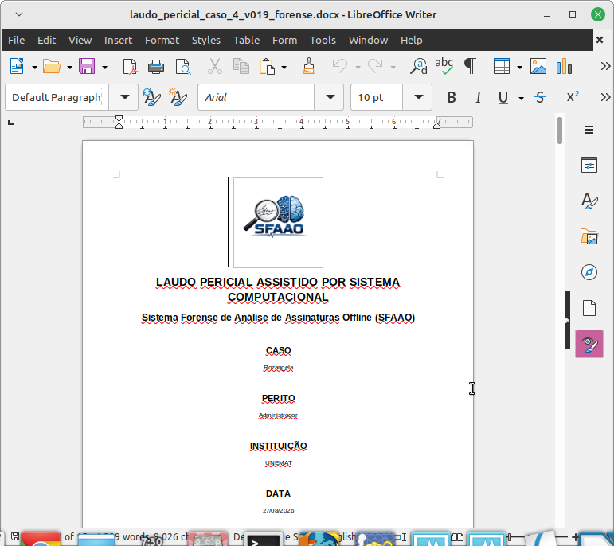
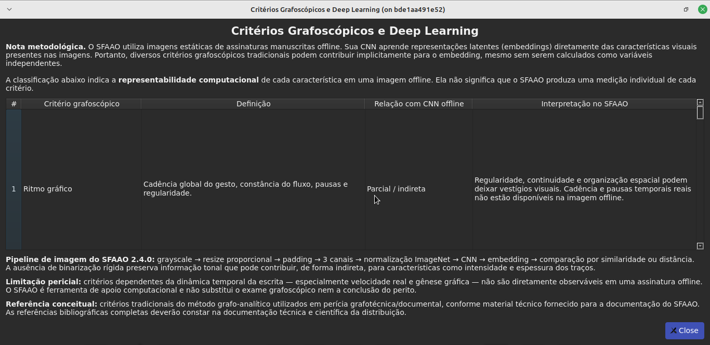

# SFAAO 2.4.0 — Notas de Lançamento / Release Notes

## Português — Brasil

### Visão geral

A versão 2.4.0 consolida melhorias na análise computacional de assinaturas manuscritas, especialmente na calibração, comparação, interface gráfica, rastreabilidade e geração de laudos.

### Funcionalidades em destaque

**Critérios grafoscópicos:** interface dedicada a 20 critérios para integração da avaliação especializada ao fluxo técnico.

**Comparação LORO/A4:** comparação individual consolidada, respeitando o domínio e as condições de calibração.

**Inspeção pairwise:** apresentação de scores individuais para análise quantitativa, sem interpretação como decisão técnica isolada.

**Comparação em lote:** processamento de múltiplas assinaturas no contexto ativo.

**Atualização de contexto:** atualização das informações necessárias ao procedimento de comparação.

**Calibração:** suporte aos protocolos forense e científico, preservando suas diferenças metodológicas.

**Laudos:** geração de relatórios técnicos em PDF e DOCX.

**Segurança:** mecanismos de licenciamento, integridade e execução local.

### Plataformas homologadas

- Linux DEB.
- Linux RPM.
- Windows EXE.

### Limitações de interpretação

Os resultados computacionais devem ser interpretados no contexto metodológico apropriado.

O SFAAO não substitui o exame grafoscópico especializado nem constitui, isoladamente, uma conclusão jurídica de autenticidade.

---

## English

### Overview

Version 2.4.0 consolidates improvements in computational handwritten signature analysis, particularly statistical calibration, signature comparison, graphical interfaces, traceability, and technical reporting.

### Highlighted Features

**Graphoscopic criteria:** a dedicated interface for 20 criteria supporting specialist assessment.

**LORO/A4 comparison:** consolidated individual comparison within the applicable calibration domain.

**Pairwise inspection:** individual quantitative scores without an independent technical decision.

**Batch comparison:** processing multiple comparisons in the active context.

**Context refresh:** updating the information used by the comparison procedure.

**Calibration:** support for forensic and scientific protocols while preserving their methodological differences.

**Reports:** technical report generation in PDF and DOCX.

**Security:** licensing, integrity verification, and local execution mechanisms.

### Validated Distributions

- Linux DEB.
- Linux RPM.
- Windows EXE.

### Interpretation Limitations

Computational results require interpretation within the appropriate methodological context.

SFAAO does not replace professional forensic handwriting examination or independently establish legal authenticity.

---

**Version / Versão:** 2.4.0

<!-- SFAAO_240_PUBLIC_UPDATE_START -->
## Interfaces atualizadas / Updated Screenshots

A versão 2.4.0 inclui interfaces atualizadas para gestão de casos,
análise grafoscópica, calibração, comparação de assinaturas e
geração de relatórios.

Version 2.4.0 includes updated interfaces for case management,
graphoscopic assessment, calibration, signature comparison,
and report generation.

**Relatório DOCX / DOCX Report:**

**20 critérios grafoscópicos / 20 graphoscopic criteria:**

<!-- SFAAO_240_PUBLIC_UPDATE_END -->
